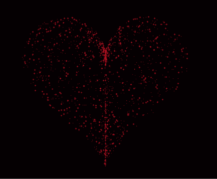

# ❤️ A Heart That Beats

*A little heart, made of particles, beating just for Val.*

This project is a Python experiment that combines mathematical equations, particle generation, and animation to create a glowing, pulsating heart.

Using Turtle Graphics, thousands of particles gradually form a heart-shaped figure, followed by a subtle heartbeat effect.

Because even a little piece of code can carry a lot of love. ♡

---

## 💗 Graphical Representation

### The final result



### 🎬 Animation preview

Watch the particles come together and bring the heart to life:

[▶ Watch the animation — heart_beat.mp4](graphical-representation/heart_beat.mp4)

---

## ✨ About the project

The program generates a collection of randomly distributed particles within a mathematical heart shape.

Each particle receives individual properties, including position, depth, size, color, and appearance timing.

As the animation progresses, the particles gradually appear, forming the heart. Once the formation is complete, a pulsating scale effect simulates a heartbeat.

### Features

- ❤️ Mathematical heart generation using parametric equations.
- ✨ Particle-based animation with 2,000 particles.
- 🎨 Dynamic color interpolation between dark red and bright red.
- 🌌 Depth-based particle positioning.
- 💓 Pulsating heartbeat effect.
- ⚡ Frame-based animation using Turtle's timer system.
- 🔴 Animated rays that accompany the heart formation.
- 💗 A little digital heartbeat made for Val.

---

## 🛠️ Built with

- **Python 3**
- **Turtle Graphics** — Drawing and animation.
- **Math** — Trigonometric equations and particle calculations.
- **Random** — Particle distribution and randomized properties.

---

## 📂 Project structure

```text
a-heart-that-beats/
│
├── main.py
├── README.md
│
└── graphical-representation/
    ├── heart.png
    └── heart_beat.mp4
```

| File | Description |
|---|---|
| `main.py` | Main script responsible for generating and animating the particle heart. |
| `graphical-representation/heart.png` | Screenshot of the final heart illustration. |
| `graphical-representation/heart_beat.mp4` | Video showing the particle formation and heartbeat animation. |
| `README.md` | Project documentation. |

---

## 🚀 Getting started

### Requirements

- Python 3.x
- Tkinter support for Python Turtle.

### Installation

Clone the repository:

```bash
git clone https://github.com/laetg404/a-heart-that-beats.git
```

Navigate to the project directory:

```bash
cd a-heart-that-beats
```

Run the script:

```bash
python main.py
```

---

## ⚙️ How it works

1. Initializes the Turtle graphics window with a dark background.
2. Defines a mathematical function to generate heart-shaped coordinates.
3. Creates 2,000 particles distributed throughout the heart.
4. Assigns each particle its own position, depth, color, size, and appearance timing.
5. Generates additional rays around the heart contour.
6. Gradually reveals the particles to form the heart.
7. Applies a pulsating scale transformation to simulate a heartbeat.
8. Updates the animation continuously using Turtle's timer system.

---

## ♡ A little dedication

A heart is made of countless little pieces, each one finding its place.

And when they all come together, something beautiful happens.

This little heart may be made of particles and code, but its inspiration is much simpler.

**It beats for you, Val. My princess, always. ♡**

---

<sub>Part of a collection of little projects created with love.</sub>

❤️
